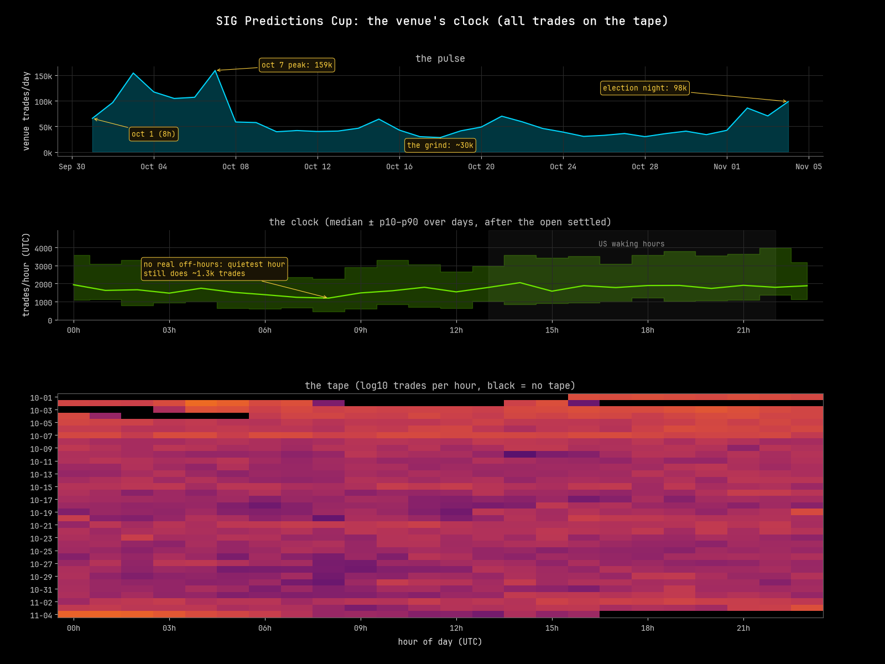
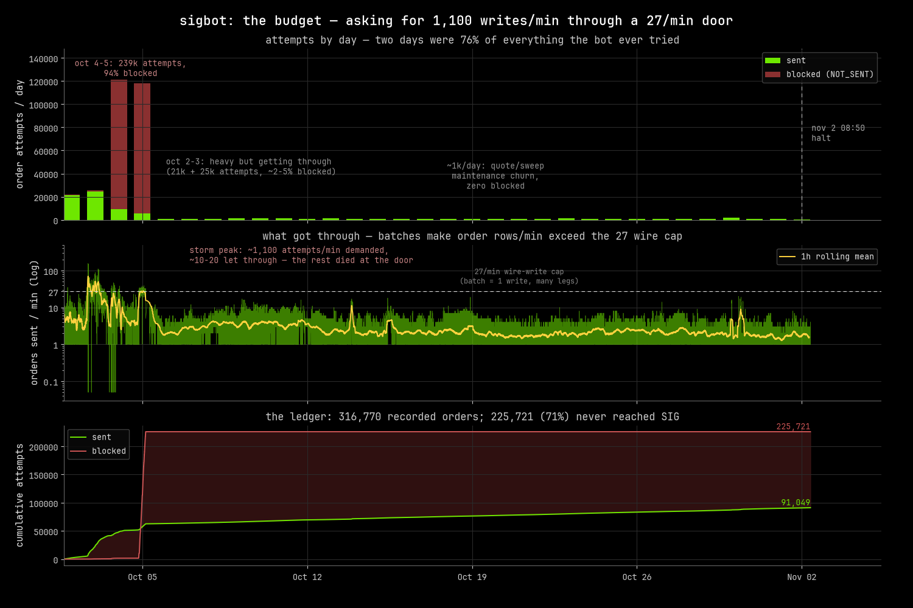
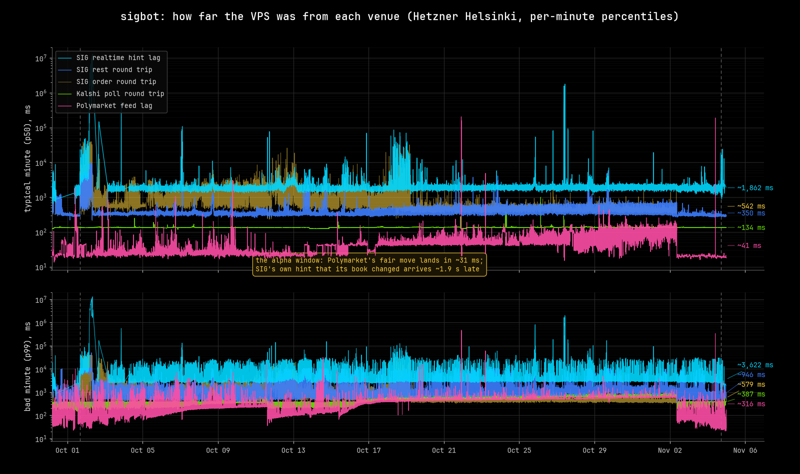
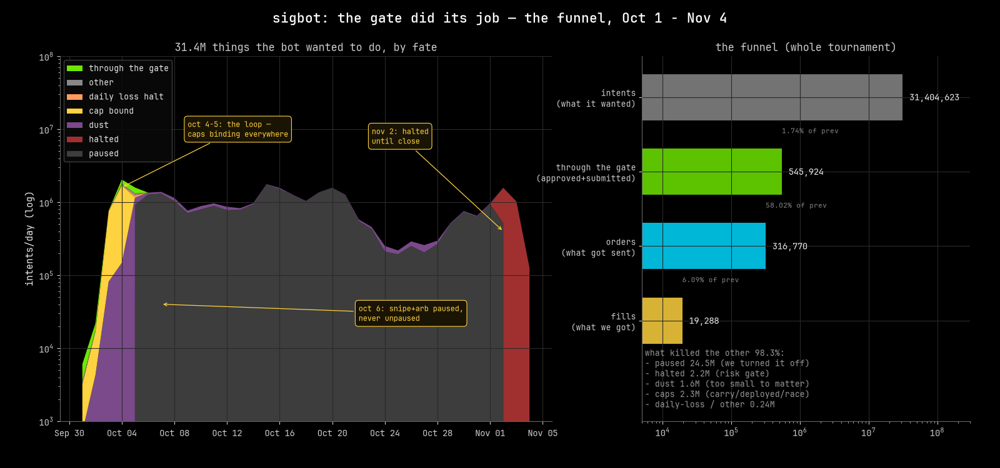
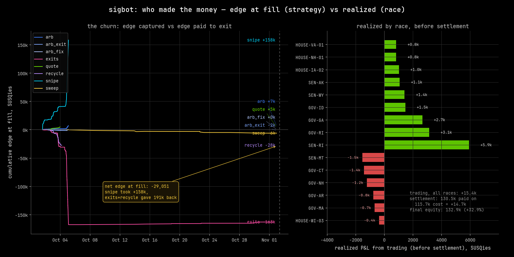
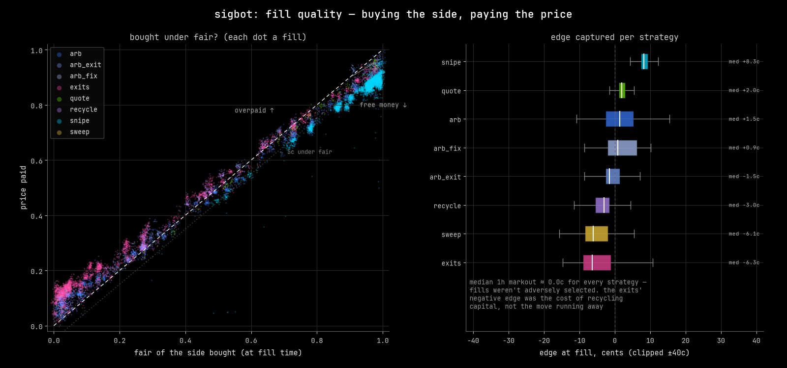
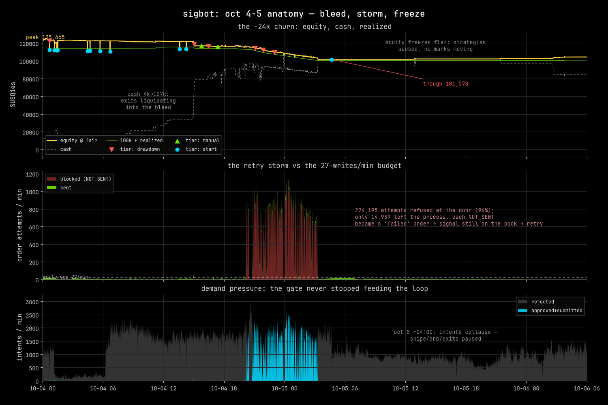
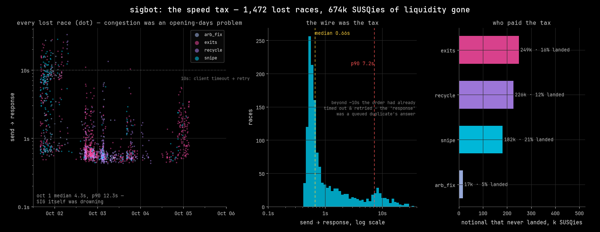
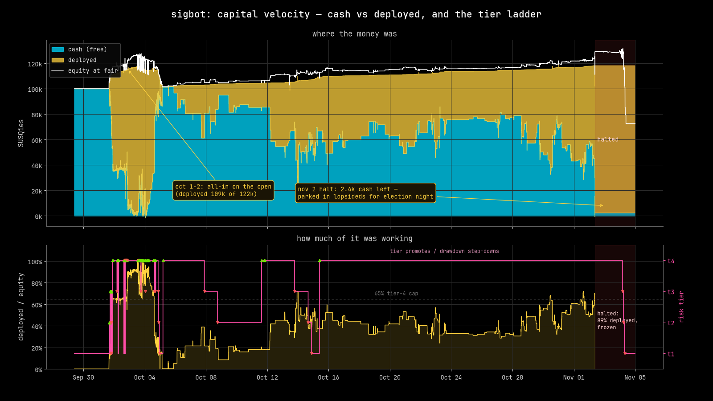
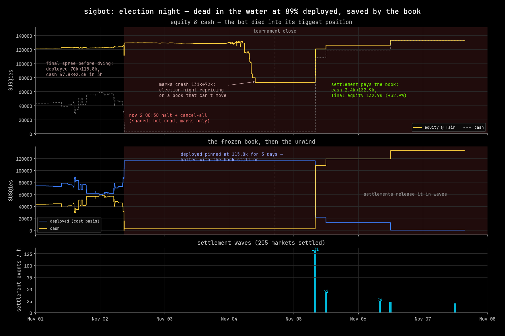

# sigbot: Predictions Cup write-up

SIG's Predictions Cup ran from 2026-10-01 16:00 UTC to 2026-11-04 17:00 UTC on `sig.thesuper.market`, a play-money
prediction market on the US midterms (100k SUSQies start, ~2,000 accounts). sigbot traded it live, unattended most
of the time, from a Hetzner VPS in Helsinki.

**Result: 100,000 → 132,919 SUSQies (+32.9%)** after every market settled (Nov 5-7).

The short version: the money came from two places, snipes on stale SIG books in the first four days and holding
near-certain outcomes to settlement. Most of the bot's complexity went into surviving one constraint (30
writes/min per key) and it lost a big chunk of early profit on Oct 4-5 to a retry loop against that constraint.
It was halted on Nov 2 and rode the election out with the book it had.

All charts are in `plots/`.

---

## 1. The venue



- The open was the busiest stretch: ~150k trades/day Oct 1-7, peaking at 159k on Oct 7, then a long grind at ~30-60k/day until election week brought it back to ~98k.
- There are no real off-hours. The quietest UTC hour still prints ~1.3k trades; US hours are only modestly busier.
- SIG's lopsided books sat ~5c away from Polymarket/Kalshi for hours, and most flow traded around SIG's own mid, not around external fair. That's why the quoter anchors on SIG's mid and not on fair.

## 2. The constraint: 27 writes/min



SIG allows 100 reads and 30 writes/min per key, and a 429 locks the key for 60 s, orders included. Every call goes
through `RequestBudget`, which keeps writes at ≤ 27/min and turns an order it can't send in time into a
`NOT_SENT` instead of a 429.

- **316,770** order rows were recorded; **91,049** actually left the process and **225,721 (71%)** were refused by the budget.
- Almost all of the refusals happened on Oct 4-5 (239k attempts, 94% blocked). Outside those two days the bot sent ~1k orders/day (quote and sweep upkeep) and the budget blocked none.
- Batches count as one write, so order rows/min can exceed 27 without breaking the cap.

## 3. Latency



From Helsinki, the typical minute (p50) looked like:

```
source                      p50      p99
---------------------------+--------+--------
Polymarket feed lag          ~31-41 ms ~316 ms
Kalshi poll round trip       ~134 ms  ~387 ms
SIG REST round trip          ~350 ms  ~946 ms
SIG order round trip         ~542 ms  ~579 ms
SIG realtime "book changed"  ~1.9 s   ~3.6 s
```

That gap is the whole snipe edge: a Polymarket move reaches the bot in tens of milliseconds, while SIG's own hint that its book changed arrives ~1.9 s later. The bot knew fair moved long before SIG's crowd did.

## 4. The funnel



```
stage                       count
---------------------------+------------
intents (what it wanted)     31,404,623
through the risk gate           545,924
orders sent / recorded          316,770
fills                            19,288
```

The gate killed 98% of intents. Most of that is the pauses: snipe and arb were paused on Oct 6 and never
unpaused, so 24.5M intents died as "paused". The rest: 2.3M on caps (carry/deployed/race), 2.2M after the
Nov 2 halt, 1.6M as dust, 0.24M daily-loss and other.

## 5. Who made the money



Edge at fill = (fair of the side bought − price paid) × quantity, summed per strategy:

```
strategy    edge at fill
-----------+-------------
snipe        +158k
arb            +7k
quote          +5k
arb_fix        ~0
arb_exit       −2k
sweep          −6k
recycle       −28k
exits        −163k
-----------+-------------
net           −29k
```

Snipes found real edge (+8.3c median per fill). The exits and recycle valve then gave all of it back and more,
selling positions below fair to free capital. Almost all of that happened in the Oct 4-5 window (section 7).

So where did the +32.9k come from? Edge at fill is measured against fair at that moment; it says nothing about
where the positions ended up. The split by realized P&L:

```
source                              SUSQies
-----------------------------------+---------
trading (realized before Nov 5)      +15.4k
settlement (130.5k paid on 115.7k)   +14.7k
marks / manual lift / rounding        +2.8k
-----------------------------------+---------
final equity vs 100k start           +32.9k
```

Trading P&L by race (right panel) was spread thin: SEN-RI +5.9k, GOV-RI +3.1k, GOV-GA +2.7k, losers no worse than
−1.5k. Settlement was the other half: the halted book was mostly lopsided favourites, and they came in.

## 6. Fill quality



- Median edge at fill: snipe +8.3c, quote +2.0c, arb +1.5c, arb_fix +0.9c; arb_exit −1.5c, recycle −3.0c,
  sweep −6.1c, exits −6.3c.
- The median 1-hour markout was ≈ 0.0c for every strategy: fills weren't adversely selected. The exits' negative
  edge was what it cost to free capital, not the market running against us.

## 7. Oct 4-5: the bleed



The worst stretch of the tournament. Equity at fair went from a **125,665** peak to a **101,578** trough (−24k).

What happened:

1. Deployed capital was pinned at the cap, so exits and recycle started selling holdings to make room, below
   fair (cash went 4k → 107k).
2. Each sale needed a write. Demand hit ~1,100 order attempts/min against a 27/min budget.
3. The budget refused **224,195** attempts (94%); only 14,939 left the process. Each `NOT_SENT` came back as a
   failed order, the signal was still on the book, so the strategy retried. That's a loop, not a strategy.
4. The risk tier ladder stepped down on drawdown, was manually re-promoted, and a restart reset the guard, which
   let the loop resume.
5. Around Oct 5 04:00 UTC snipe, arb and exits were paused. Equity froze flat.

**Lesson:** a refused order must cool the signal down, not fail and be retried the next tick. The budget did its
job (no 429s, no lockout); the strategies didn't respect it.

## 8. The speed tax



**1,472** lost races: orders sent to take liquidity that was gone when they arrived. Only ~14% of the wanted
quantity filled in those races; ~674k SUSQies of notional never landed (exits 249k, recycle 226k, snipe 182k,
arb_fix 17k).

- Send → response median was 0.66 s, p90 7.2 s.
- Oct 1 was SIG itself drowning: median 4.3 s, p90 12.3 s. Past ~10 s the client had timed out and retried,
  so the "response" was a queued duplicate's answer.
- After the opening days, lost races mostly stopped. Congestion was an opening-week problem, not a geography one.
- `signal_to_send_ms` and `book_age_ms` were never populated by the recorder, so this is wire-side only.

## 9. Capital velocity



- Oct 1-2: all-in on the open (deployed 109k of 122k).
- After Oct 5: deployed mostly 30-60% of equity, under the 65% tier-4 cap, with a long quiet middle where the
  tier ladder sat at t4.
- Election week: deployment climbed back toward the cap, then the final spree before the halt.

## 10. Election night



The plan was for election night to be the main lever. The bot was already halted.

- **Nov 2 08:50 UTC:** halt + global cancel-all. In its last ~3 hours it took deployed from 70k to **115.8k (89%
  of equity)** and cash from 47.8k to **2.4k**.
- For three days the book sat frozen. Marks crashed from 131k to 72k on election-night repricing, on a book that
  couldn't move.
- Settlement paid it out in waves (205 markets, Nov 5-7): cash went 2.4k → 132.9k.

Every order/fill row ends Nov 2 ~09:00. Everything after is marks, settlement, or the manual `lift_once.py`
(which never wrote to the orders table).

---

## What I'd do differently

- **Back-pressure from the budget to the strategies.** A `NOT_SENT` should put that signal on cooldown. This one
  change would have saved most of the Oct 4-5 bleed.
- **Don't make capital recycling a taker.** Exits and recycle paid −191k of edge to free capital. Resting exits
  (quoting out) or a much tighter hurdle would have kept most of the snipe profit.
- **Fix the guard reset.** A restart shouldn't reset the drawdown ladder.
- **Record the full latency chain.** `signal_to_send_ms` / `book_age_ms` were in the schema and never filled.
- **Don't halt into the main event.** The best planned edge (called-race sweeps) never ran; the result came
  from a book that happened to be right.
